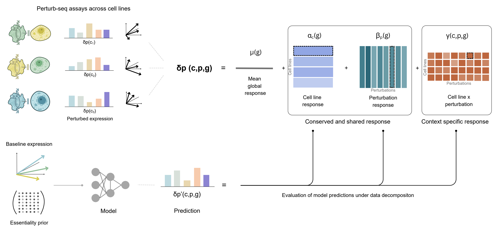
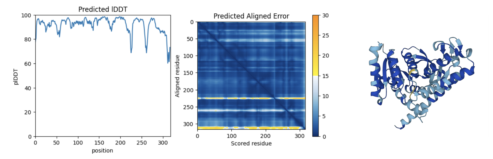
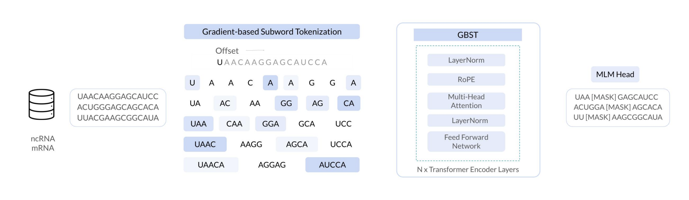
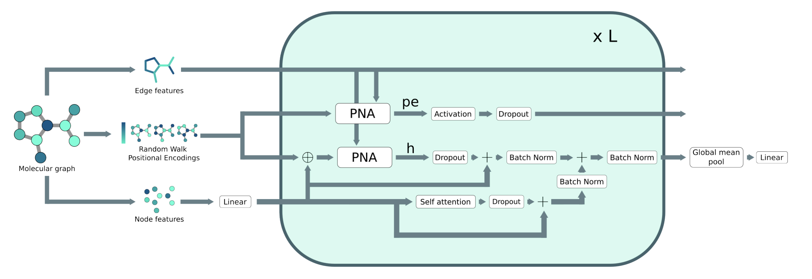
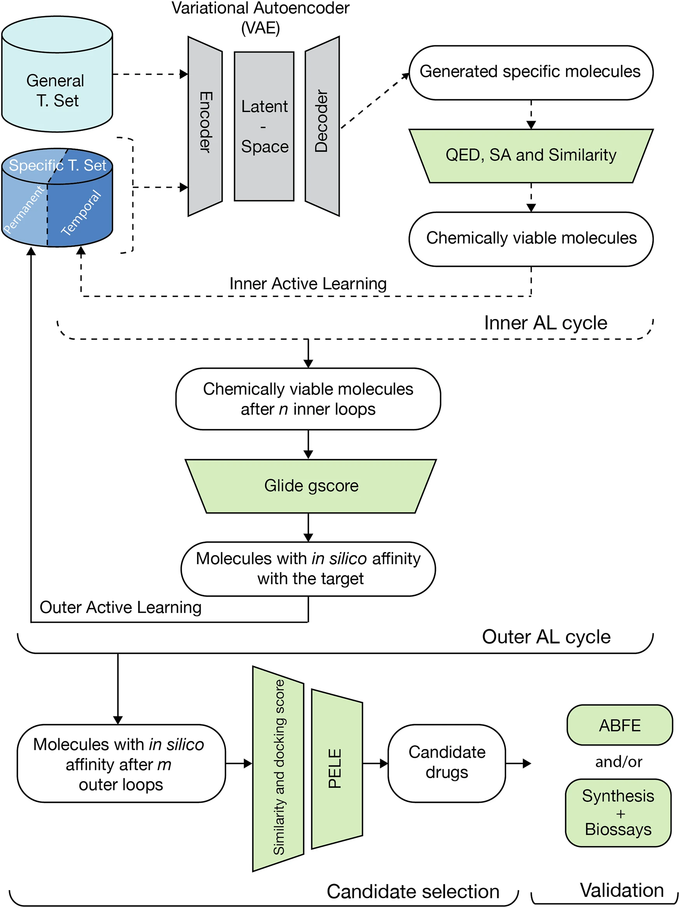
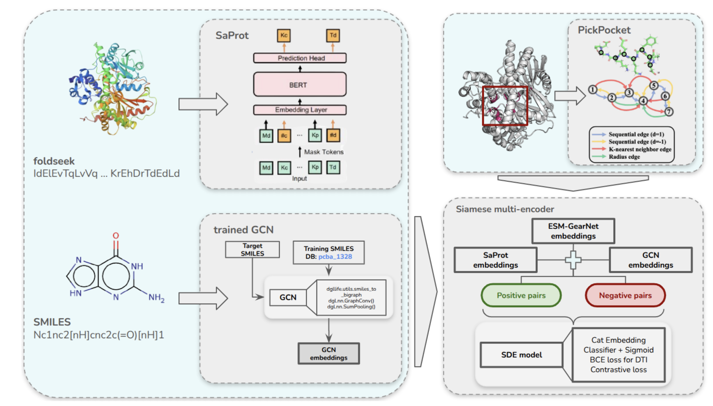

I am a Predoctoral Fellow at [AITHYRA](https://www.aithyra.at/), supervised by [Xinyi Zhang](https://scholar.google.com/citations?hl=en&user=2gU9PYQAAAAJ). My current research focuses on developing machine-learning methods to understand and predict how biological systems respond to genetic and chemical perturbations, particularly across different cellular contexts. In parallel, I am interested in learning biologically meaningful representations of cellular state from complementary modalities, enabling us to understand and predict phenomena such as protein localization and how these vary across cells, tissues, and biological conditions.

Previously, I was Director of AI at Nostrum Biodiscovery, where I led research on binding-affinity prediction, surrogate models for molecular docking, protein–ligand modelling, and generative approaches to molecular design.

More broadly, I am interested in how biological representations, model inductive biases, and evaluation frameworks determine the ability of machine-learning systems to generalize beyond the experimental conditions on which they were trained. Ultimately, I want to connect our understanding of cellular responses, molecular interactions, and biological context to identify therapeutic vulnerabilities and develop interventions that exploit them selectively.

## Research interests

* **Perturbation biology and cellular response modelling** — Understanding and predicting how genetic and chemical interventions reshape cellular states, and how these responses generalize across perturbations, cell types, and biological contexts.

* **Multimodal and multiscale representations of biological systems** — Integrating transcriptomic, morphological, spatial, and molecular information to learn representations of cellular states and functions, with particular interest in protein localization and transferring observations across biological scales.

* **Context-aware therapeutic discovery** — Combining functional genomics, cellular phenotypes, and molecular modelling to identify disease-relevant vulnerabilities, prioritize therapeutic targets, and develop molecular interventions, including targeted inhibition and protein degradation.

### Research highlights

> These projects are collaborative efforts. Although I supervised many of them, they were made possible by the interns, team members, and collaborators listed as co-authors. I am always happy to discuss the work, but please consider reaching out to them too.

#### Cellular modelling and perturbation biology

* *Perturbation Response Decomposition Enables Biologically Aligned Generalization to Unseen Perturbations and Cellular Contexts* — **bioRxiv, 2026** · [[paper](https://www.biorxiv.org/content/10.64898/2026.07.24.740459v1)] — Decomposes transcriptional responses into shared, perturbation-specific, cellular-context and interaction components to determine what predictive models recover.

{
      width=80%
      fig-align="center"
      fig-alt="Overview of the perturbation-response decomposition framework."
    }

#### Protein and RNA language models

* *Are Protein Language Models Compute Optimal?* — **ICML 2024 Workshop on Accessible and Efficient Foundation Models for Biological Discovery (AccMLBio)** · [[paper](https://openreview.net/forum?id=Y4yma8kJo1)] — Studies how protein-language-model size, training data, and compute should scale together.

* *Efficient and Accurate Sequence Generation with Small-Scale Protein Language Models* — **bioRxiv, 2023** · [[paper](https://www.biorxiv.org/content/10.1101/2023.08.04.551626v1)] — Explores whether compact protein language models can generate biologically meaningful sequences without very large architectures.

{
      width=80%
      fig-align="center"
      fig-alt=""
    }

* *Character-level Tokenizations as Powerful Inductive Biases for RNA Foundational Models* — **ICLR 2025 Workshops on AI for Nucleic Acids (AI4NA) and Learning Meaningful Representations of Life (LMRL)** · [[paper](https://arxiv.org/abs/2411.11808)] — Investigates learnable character-level tokenization for RNA foundation models.

{
      width=80%
      fig-align="center"
      fig-alt=""
    }

#### Virtual screening and molecular modelling

* *Scoreformer: A Surrogate Model for Large-Scale Prediction of Docking Scores* — **ICML 2024 Workshop on Machine Learning for Life and Material Science: From Theory to Industry (ML4LMS)** · [[paper](https://openreview.net/forum?id=nLIbjNPgHj)] — Develops a surrogate model for rapidly approximating docking scores across large molecular libraries.

{
      width=80%
      fig-align="center"
      fig-alt=""
    }

* *Optimizing Drug Design by Merging Generative AI with a Physics-Based Active Learning Framework* — **Communications Chemistry, 2025** · [[paper](https://www.nature.com/articles/s42004-025-01635-7)] — Combines molecular generation, physics-based modelling and active learning to iteratively improve candidate molecules.

{
      width=60%
      fig-align="center"
      fig-alt=""
    }

* *Informed Protein–Ligand Docking via Geodesic Guidance in Translational, Rotational and Torsional Spaces* — **Nature Machine Intelligence, 2025** · [[paper](https://www.nature.com/articles/s42256-025-01091-x)] — Introduces geometry-aware guidance for protein–ligand docking across translational, rotational and torsional search spaces.

* *Tensor-DTI: Enhancing Biomolecular Interaction Prediction with Contrastive Embedding Learning* — **ICLR 2025 Workshops on Generative and Experimental Perspectives for Biomolecular Design (GEM) and Learning Meaningful Representations of Life (LMRL); extended preprint on arXiv, 2026** · [[paper](https://arxiv.org/abs/2601.05792)] — Uses structured contrastive representations for drug–target interaction and affinity prediction.

{
      width=80%
      fig-align="center"
      fig-alt=""
    }

* *Addressing Model Overcomplexity in Drug–Drug Interaction Prediction with Molecular Fingerprints* — **Journal of Cheminformatics, 2026** · [[paper](https://link.springer.com/article/10.1186/s13321-025-01128-8)] — Shows that simple molecular fingerprints can match or outperform substantially more complex architectures on common interaction benchmarks.

#### Graph and topological deep learning

*Most of my work in geometric deep learning is pursued in collaboration with [Bertran Miquel](https://bertranmiquel.github.io/). For further details on this research direction, please visit his website or contact him directly.*

* *Effective Resistance Rewiring: A Simple Topological Correction for Over-Squashing* — **arXiv, 2026** · [[paper](https://arxiv.org/abs/2603.11944)] — Uses effective resistance to identify and correct structural bottlenecks that limit long-range information propagation in graph neural networks.

* *TopoBench: A Framework for Benchmarking Topological Deep Learning* — **Journal of Data-centric Machine Learning Research, 2025** · [[paper](https://openreview.net/forum?id=07sTzyEVtY)] — Provides a common framework for evaluating learning methods across graphs and higher-order topological domains.

* *ICML Topological Deep Learning Challenge 2024: Beyond the Graph Domain* — **Proceedings of the ICML 2024 Geometry-grounded Representation Learning and Generative Modeling Workshop (GRaM), PMLR volume 251** · [[paper](https://proceedings.mlr.press/v251/bernardez24a.html)] — Defines benchmark tasks for learning across graphs, hypergraphs and topological complexes.

